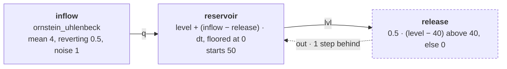

# Diagrams and stochadex configs

A diagram of a system and a stochadex config say the same things. A box is a **partition**,
a thing with a state that changes over time. An arrow is a **read**, one thing's state going
into another's update. This skill is the mapping in both directions. The `config` skill
covers writing the YAML itself, and the `experiment` skill runs the loop that uses both.

## Reading a diagram

Take a diagram in whatever form it comes. For an image, look at it; for a file (Mermaid,
DOT, draw.io XML, Excalidraw JSON), read its nodes, edges and every label. Then say back what
you read before building anything, as the notation below, so a misreading costs one message
and not a wrong model.

Sort every element into one of these:

| In the diagram | In the config |
|---|---|
| A box whose quantity changes over time (a stock, level, population, price, queue, a state of a machine) | a partition |
| A box that is random, or labelled as noise, arrivals, demand, weather, shocks | a partition with a built-in stochastic process, or an expression with a draw |
| A box that is a fixed number (a rate, capacity, threshold, target) | a `params` entry of whichever partition reads it, not a partition |
| A box that is data (a file, a table, a measurement series) | an entry of `inputs:`, replayed by a `from_input` partition |
| A box that summarises, estimates or optimises (an average, a fit, a controller tuned to data) | a `macros:` entry, or a partition that reads the others |
| An arrow A → B | B reads A (see timing below) |
| A box drawn inside another, or a "for each scenario" frame | an `embedded_simulation_run`, or `run: {mode: ensemble}` |
| A label on an arrow or box (`+`, `−`, "delay", a formula, a number, a unit) | the sign, lag, expression or parameter value it states |
| A note about what should happen ("settles near 40", "never negative", "oscillates") | a **claim** to test, not part of the model |

**Timing is the one thing most diagrams leave out, and a config must state.** Every arrow is
either a read of this step's value or of the last committed one:

- **This step** (`params_from_upstream`, drawn solid): B is derived from A's new value. Use
  it for a flow computed from a level, an observation of a state, a rule applied to a
  reading.
- **One step behind** (an expression's `upstreams:`, drawn dashed): B uses where A was. Use
  it for feedback, for anything the diagram marks as a delay, and to break loops.

The this-step arrows must not form a loop, or nothing in it can go first. So for every loop
in the diagram, at least one arrow must be one step behind. Which one is a modelling choice,
so make it by asking what each box knows when it acts:

- **A decision, or a flow limited by a stock** (sales capped by what is on the shelf, a
  release that depends on the level) reads the stock as it stood at the start of the step:
  one step behind. The stock then reads that flow this step, so it never gives out more than
  it had.
- **A slow feedback** (a policy, a price, a population responding to another) reads one step
  behind, and what it drives may read it this step.
- **Two boxes that drive each other continuously** (predator and prey) read each other one
  step behind, both ways: the explicit Euler step.

**A delay** ("arrives after 3 days") is a read several steps behind: a dashed arrow labelled
with the number of steps. The `config` skill's "A delay" shows how it is written.

**What a diagram rarely says, you must decide and declare:** each partition's update rule
and parameter values, initial states, the time step and run length, seeds, and which arrows
are one step behind. Where the diagram or the user doesn't say, pick a simple, conventional
choice and record it as an **assumption**. Ask the user only about things that would change
the structure of the model, such as whether a box is a state or a constant. Do not ask about
values you can assume and they can correct at a glance.

## The notation

The working copy of the diagram is a Mermaid flowchart, in a Markdown file, in a notation
that carries everything a config states. It renders on GitHub, in most editors and in Claude.



- **A node is a partition**, with the partition's name as its id and its first line. The
  second line is its update: the built-in's name, or the expression in plain words. The third
  is what matters of its parameters and initial state.
- **A solid arrow is a this-step read** and **a dashed arrow is a read one step behind**.
  The label is the name the reader knows it by: the `params_from_upstream` key, or the
  `upstreams:` alias. A longer delay says so in the label: `out · 3 steps behind`.
- **An arrow the user did not draw**, which the model needed, ends its label `· added`, and
  one whose timing you chose ends it `· assumed`.
- **Shapes** for what is not a plain partition: `[("name")]` (a cylinder) for an input,
  `{{"name"}}` (a hexagon) for a macro, and a `subgraph` for an embedded run, holding its
  inner partitions.
- **Classes** carry the status of a node. `assumed` (dashed border) marks one whose rule or
  values you chose because the diagram didn't say. `added` marks a partition the model needed
  that the user did not draw. `failing` marks a partition that a failed claim is about.
- Keep the user's names, their left-to-right or top-to-bottom direction, and their order of
  nodes. The file is their diagram with more written on it, never a redrawing.

## Checking a config against a diagram

A config matches a diagram when they have the same nodes and the same arrows with the same
timing. Do not judge that by reading the YAML you wrote. Ask the engine, which reports the
wiring the run will use:

```bash
stochadex graph -c model.yaml
```

```text
flowchart TB
  n0["inflow"]
  n1["reservoir"]
  n2["release"]
  n2past["release"]
  n0 -->|q| n1
  n2past -.->|out| n1
  n1 -->|lvl| n2
  classDef pastcopy fill:#d8e6f3,stroke:#4a7ba6,color:#000;
  class n2past pastcopy;
```

Read it against the diagram, arrow by arrow:

- `nA -->|key| nB` is a this-step read: the diagram must have a solid arrow A → B.
- `nApast -.->|name| nB` is a read one step behind, drawn from a shaded past copy of A so
  that the graph has no loops: the diagram must have a dashed arrow A → B. An expression's
  `upstreams:` are exact. A built-in's `params_as_partitions` entry is drawn the same way and
  means the built-in may read that partition's history.
- Every arrow in the diagram must appear, and every arrow printed must be in the diagram. An
  extra or a missing arrow is a mistake in the config or something to add to the diagram,
  and you say which.
- A node classed `deadlock` is in a loop of this-step reads. The command also names the
  loop and exits 78. Make one of its arrows one step behind, in the config and the diagram.
- A `macros:` config is drawn as its expansion, so one macro appears as several partitions.
  In the diagram keep it as one hexagon, and check its arrows in and out.

How far behind a dashed arrow reads is not in the graph either: a 3-step delay prints like a
1-step read. Check it by reading the `lag(...)` in the reader's expression.

Parameter values and update rules are not in the graph. Check those against the diagram's
labels by reading the config's `params:` and expressions, and against the engine's own
account of a built-in with `stochadex catalogue | jq '.iterations[] | select(.name == "NAME")'`.

## Writing results back onto the diagram

After a run, the diagram is updated to show what the model did, so that the user's next idea
starts from the model's behaviour and not from the first sketch.

- Add a last line to each node's label with what was observed, in the fewest numbers that
  describe it: `final 48.0 ± 0.8`, `mean 4.06, range 0 to 6.2`, `settles by t ≈ 20`. Replace
  the previous run's line; do not stack them.
- Class a node `failing` when a claim about it failed, and say which claim under the diagram.
- A node shows the values in `model.yaml`. When an experiment varied something with `--set`
  (a sweep), the node keeps the file's value and its observed line gives the range tried and
  what changed across it: `unmet 17% at reorder point 20, 3.5% at 30`.
- Change the structure of the diagram only when the model's structure changed, and class
  what is new as `added`. Remove `assumed` from a node once the user has confirmed or set it.
- Never draw something the config does not do. If the diagram and the config disagree,
  correct one of them and say so.
